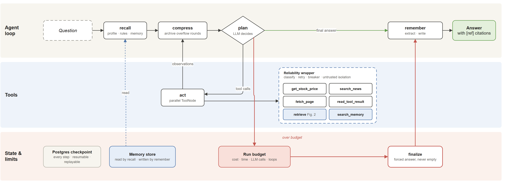
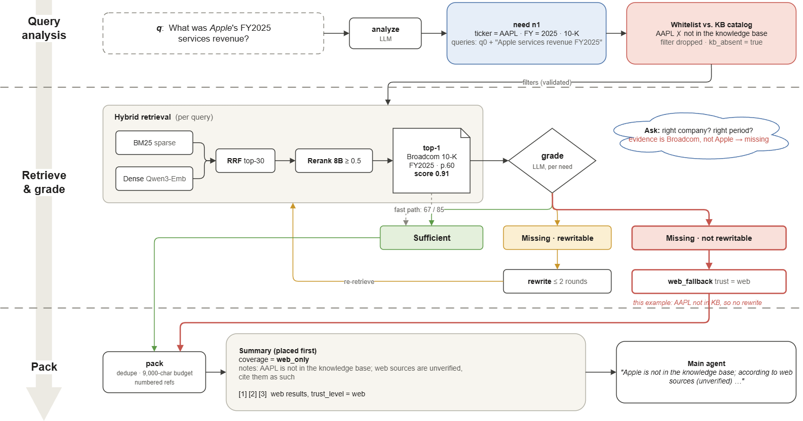
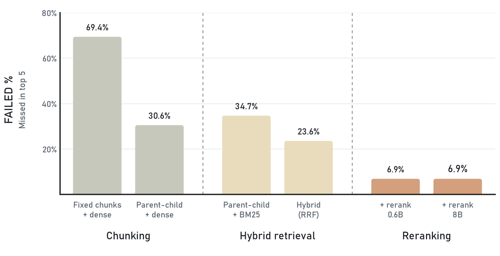
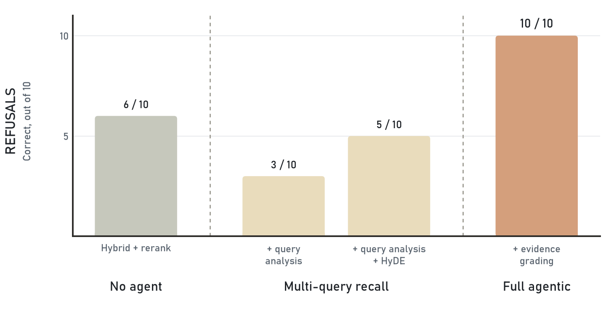
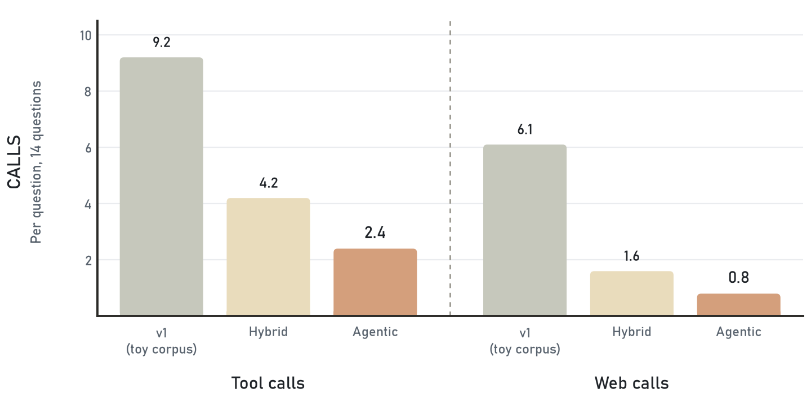
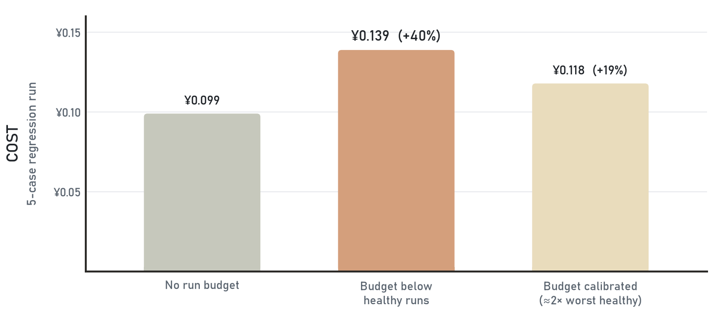

# Finance Research Agent

**A research agent that answers questions about semiconductor companies from their official filings, with citations, measured at every layer.**

English | [简体中文](README.zh-CN.md)


---

## Abstract

General-purpose LLM agents are unreliable for financial research. They invent figures, mix up companies and fiscal years, give up or loop when a data source fails, and run out of context on long tasks. This project builds a research agent for the AI-chip sector and treats each of those failure modes as a separate engineering problem with its own evaluation.

The agent started as a hand-written tool-calling loop (M1) and was rebuilt as an explicit LangGraph state machine. Around that core it has hybrid retrieval over **21 official filings** (SEC 10-K/10-Q and CNINFO annual/interim reports), a self-correcting *agentic retrieval* subgraph, typed long-term memory, incremental context compression, a reliability layer and an observability layer. Every component was accepted against an offline ablation or a fault-injection suite, never against a single demo.

| Headline result | Before | After | Where |
|---|---|---|---|
| Retrieval Hit@5 (72 fact questions) | 0.31 | **0.93** | [§4.2](#42-retrieval-ablation) |
| Correct refusals on unanswerable questions | 6 / 10 | **10 / 10** (0 / 75 false refusals) | [§4.3](#43-agentic-retrieval) |
| Tool calls per end-to-end question | 9.2 | **2.4** | [§4.4](#44-end-to-end) |
| Cross-user memory isolation | 0 / 3 | **3 / 3** | [§4.6](#46-memory) |
| Offline regression checks (zero API cost) | — | **287 / 287 pass** | [§4.5](#45-reliability) |

---

## 1. Problem

Four failure modes drive the design. Each later section maps back to one of them.

| # | Failure mode | Concrete symptom observed in this project | Addressed by |
|---|---|---|---|
| P1 | **Ungrounded numbers** | The answer quotes a revenue figure that appears in no source | Citations, number-grounding checks, evidence grading |
| P2 | **Wrong entity or period** | A question about *Apple* is answered with *Broadcom*'s "subscription and services" revenue, which scored 0.91 on the reranker | Metadata filters with whitelisting, evidence grading |
| P3 | **Brittle tools** | `fetch_page` failed 47 % of the time in one evaluation run, and every failure still went through the full retry-and-backoff cycle | Failure taxonomy, circuit breaker, run budgets |
| P4 | **Context exhaustion** | A single 12k-character filing excerpt pushes earlier evidence out of the window | Incremental archive, pinned facts, read-back tool |

---

## 2. System overview

### 2.1 Agent graph

<p align="center">
  
</p>

<sub>**Figure 1.** The agent graph in three lanes. The loop (top) plans, calls tools in parallel and compresses context between steps. Every tool runs inside the reliability wrapper (middle). State is checkpointed to PostgreSQL after every step, memory is read before planning and written after answering, and a run that exceeds its budget is routed to `finalize`, which still produces an answer (bottom).</sub>

The graph state is checkpointed to PostgreSQL after every step, so a run can resume in a new process and every step can be replayed. The hand-written loop (`core/agent.py`) is kept with the **same interface** as a reference implementation, and the whole evaluation suite runs unchanged against both.

### 2.2 Agentic retrieval subgraph (`retrieve` tool)

<p align="center">
  
</p>

<sub>**Figure 2.** The `retrieve` subgraph, traced with a real question the knowledge base cannot answer. Query analysis drops the AAPL filter because Apple is not in the catalog; hybrid retrieval returns a Broadcom paragraph scoring 0.91; grading rejects it as the wrong company, so the run falls back to the web and the summary marks coverage as `web_only`.</sub>

`analyze` splits the question into 1–3 information needs with metadata filters; `grade` checks each need for the right company and period; `pack` deduplicates, applies the evidence budget and puts a coverage summary first (details in [§3.2](#32-agentic-retrieval-p1-p2)).

Inside `retrieve`, each query runs a two-stage pipeline. **BM25** (jieba tokens, sparse vectors stored in Qdrant) and **dense** retrieval (Qwen3-Embedding) each return 30 candidates. **Reciprocal Rank Fusion** merges them, and the **Qwen3-Reranker-8B** cross-encoder reorders the merged list with a calibrated 0.5 threshold. Each hit is then expanded from its child chunk to the parent section.

### 2.3 Stack

| Layer | Choice |
|---|---|
| Orchestration | LangGraph (graph, `ToolNode`, Postgres checkpointer); hand-written loop kept for comparison |
| LLM | DeepSeek (OpenAI-compatible; Kimi / OpenAI switchable by env) |
| Retrieval | Qdrant 1.13 (dense + sparse named vectors), Qwen3-Embedding-0.6B, Qwen3-Reranker-8B |
| Storage | PostgreSQL 16: source text, idempotent ingest hashes, procedural memory, checkpoints |
| Tools | Yahoo chart API, DuckDuckGo, guarded page fetch; also exposed as an **MCP server** (FastMCP) |
| Observability | LangGraph callbacks → JSONL logs and metrics; OpenTelemetry → Phoenix |

---

## 3. Method

### 3.1 Corpus and ingestion (P1, P2)

- **Sources.** 15 SEC filings (NVIDIA, AMD, Broadcom, Intel, Micron: latest two 10-Ks and one 10-Q) and 6 CNINFO reports (Cambricon, SMIC, Hygon: latest annual and interim report). Each document carries `ticker`, `doc_type`, `fiscal_year`, `period_end` and `trust_level=official`. Pinned file lists are in [`data/manifests/`](data/manifests/), and the raw files can be re-downloaded with `rag/sources/fetch_*.py`.
- **Structure-aware parsing.** SEC HTML is split on page breaks and item headings. PDFs are parsed with PyMuPDF, with tables flattened row by row, because most financial figures live in tables.
- **Parent-child chunks with contextual headers.** Small child chunks are indexed for precise matching. The parent section is returned for context. Each chunk is prefixed with *company / filing / section*.
- **Idempotent ingest.** The content hash is written *last*, so a crash mid-ingest is redone on the next run instead of being skipped forever. The hash includes a parser version, so fixing the parser re-ingests old documents.

### 3.2 Agentic retrieval (P1, P2)

- **Query analysis** produces 1–3 *information needs*, each with its own queries and metadata filters. The prompt includes the KB catalog (companies, fiscal years, fiscal-year end months).
- **Filter whitelisting.** Every LLM-proposed filter value is checked against values that actually exist in the KB. `AAPL`, misspelled tickers and future years are dropped and logged. Empty results relax filters in a fixed order: fiscal year → doc type → ticker.
- **Evidence grading** checks each need for *right company and right period*. It exists because rerank scores alone cannot detect "a highly relevant paragraph about the wrong company" (§4.3).
- **Fast path.** A single need with valid filters and top-1 ≥ 0.9 skips grading. 67 of 85 questions take this path, so the LLM cost of grading is spent only where it matters.
- **Coverage summary** is placed first in the tool output (`sufficient / missing / web_only`, plus notes). It tells the main agent when to *stop searching*. The system prompt forbids substituting another company's or period's figures.

### 3.3 Reliability layer (P3)

| Mechanism | What it does |
|---|---|
| **Run budgets** | Four independent stop lines: cost, wall-clock, LLM calls and loop detection. When a budget is hit, the run is routed to a `finalize` node that still produces an answer instead of an empty result |
| **Failure taxonomy** | Four classes: transient, deterministic, budget and side-effect-unknown. Only transient failures are retried; a 403 is tried once instead of three times |
| **Circuit breaker** | Three-state breaker per dependency, so repeated calls to a dead dependency are rejected immediately |
| **Structured errors** | The model sees *error + attempt history + recovery hint*, not a bare string |
| **Untrusted content isolation** | Fetched pages are wrapped in a marked untrusted block with an instruction not to follow embedded instructions. An SSRF guard blocks private and loopback addresses |
| **Durable execution** | `PostgresSaver` checkpoints. A second process can resume a run started by the first |

### 3.4 Memory (P2)

Memory is split into **episodic / semantic / procedural** types. Writes go through LLM extraction into structured candidates, with hard caps enforced in code. Updates are resolved by exact key supersession first and fuzzy vector conflict detection second. Reads combine an always-on profile, a memory catalog and threshold-gated recall with three-factor re-ranking (similarity, recency, importance). `user_id` isolation is enforced at the interface: the `search_memory` tool has **no** `user_id` parameter and reads it from the run config. Recalled memory is injected as user-level content, never as a system message, so web-derived content cannot come back later with system authority.

### 3.5 Context compression (P4)

Compression replaces "summarize everything every turn" with an **incremental archive**. Only rounds that overflow a calibrated high-water mark are archived, and facts extracted during archiving are verified against the source text before being *pinned*. Long tool results are shown as a preview and can be paged in with `read_tool_result`. Failure records are pinned by code, so the agent does not repeat a call that already failed. Preview length is configurable per tool, because retrieval output is already filtered and should not be cut (§5, finding 3).

### 3.6 Observability

Callbacks attached to the graph config record per-node latency, tokens (including cached tokens), cost by cache tier, tool failures and retries, and the stop reason. **Content is not logged by default.** One summary line is printed per run:

```
[obs] run=42216156 19.1s | LLM 4 calls (in 4694 / cached 3200, out 546) | tools 6 | plan=9.3s act=7.2s
```

The same events can be exported over OpenTelemetry to Phoenix as a waterfall trace. Evaluation reports include cost and latency next to quality.

---

## 4. Experiments

### 4.1 Setup

| Item | Value |
|---|---|
| Corpus | 24 documents (21 official filings + 3 synthetic glossary notes), ≈ 9.9k indexed chunks |
| Retrieval golden set | 85 questions: 72 *fact* (48 Chinese / 24 English; 37 numeric / 35 narrative), 3 *compare*, 10 *no-answer* |
| Relevance rule | A chunk is relevant if it contains the answer span, which is verified to appear verbatim in the source. The rule is text-based, so different chunking schemes are scored on the same questions |
| End-to-end set | 14 hand-written questions (not derived from the golden set), including a routing negative and two unanswerable questions |
| Judge | LLM-as-judge rubric (accuracy / completeness / faithfulness) plus deterministic checks: tool use, number grounding, citation validity |

### 4.2 Retrieval ablation

<picture>
  <source media="(prefers-color-scheme: dark)" srcset="assets/figures/retrieval-ablation-dark.png">
  
</picture>

<sub>**Figure 3.** Share of the 72 fact questions whose answer chunk is missed in the top 5 (1 − Hit@5), same 24 documents throughout. Structure-aware chunking, hybrid retrieval and reranking each cut failures; the two rerankers tie here and differ in ranking precision (Hit@1 0.72 vs 0.82).</sub>

| # | Configuration | Hit@1 | Hit@5 | Hit@30 | MRR | Latency p50 / p95 |
|---|---|---|---|---|---|---|
| 0 | Fixed 500-char chunks + dense (v1) | 0.153 | 0.306 | 0.542 | 0.228 | 1.1 s / 1.6 s |
| 1 | Parent-child chunks + dense | 0.431 | 0.694 | 0.889 | 0.560 | 0.6 s / 0.8 s |
| 2 | Parent-child chunks + BM25 | 0.431 | 0.653 | 0.694 | 0.516 | 44 ms / 45 ms |
| 3 | Hybrid (RRF) | 0.542 | 0.764 | 0.931 | 0.640 | 0.6 s / 0.9 s |
| 4 | Hybrid + rerank 0.6B | 0.722 | 0.931 | 0.931 | 0.808 | 1.6 s / 2.3 s |
| **4b** | **Hybrid + rerank 8B** | **0.819** | **0.931** | 0.931 | **0.871** | 2.7 s / 7.2 s |

<sub>Source: [`results/retrieval/rag_offline_20261022.json`](results/retrieval/rag_offline_20261022.json); the figure is regenerated from it by [`results/make_figures.py`](results/make_figures.py).</sub>

**Why hybrid.** Grouping the questions shows that the two retrievers fail on different questions:

| Question group | n | Dense Hit@5 | BM25 Hit@5 | Hybrid + 8B |
|---|---|---|---|---|
| Chinese question → English SEC filing | 21 | 0.62 | **0.05** | 0.86 |
| Question → Chinese annual report | 24 | **0.54** | 0.88 | 0.96 |
| English questions | 24 | 0.88 | 0.92 | 0.96 |

A Chinese question about an English filing shares no tokens with it, so BM25 finds almost nothing (0.05). Questions about Chinese annual reports ask for exact line items such as trading financial assets or R&D spend, which is where literal matching wins and dense retrieval reaches only 0.54. Thirteen questions are top-5 for dense but outside BM25's top 10, and six are the other way round.

**Why the 8B reranker.** Both rerankers reach the Hit@30 ceiling (0.931), so they differ in *ranking precision* (Hit@1 0.722 vs 0.819) and in whether a usable threshold exists. With the 0.6B model, the *median* irrelevant chunk scores 0.970, so no threshold separates relevant from irrelevant chunks. With the 8B model, a threshold of 0.5 keeps 98 % of relevant chunks and drops 70 % of irrelevant ones.

**Why top-k = 5.** On rows 4/4b, Hit@3 is 0.889 / 0.917, and Hit@5 and Hit@10 are both 0.931. The curve flattens at 5.

### 4.3 Agentic retrieval

<picture>
  <source media="(prefers-color-scheme: dark)" srcset="assets/figures/agentic-refusal-dark.png">
  
</picture>

<sub>**Figure 4.** Correct refusals on 10 unanswerable questions. Multi-query recall alone makes refusal worse; evidence grading restores it with 0 / 75 false refusals.</sub>

| # | Configuration | Hit | MRR | Correct refusal | False refusal | LLM tokens / q | Latency p50 / p95 |
|---|---|---|---|---|---|---|---|
| 4b* | Hybrid + 8B + threshold, top 5 | 0.903 | 0.850 | 6 / 10 | 0 / 75 | 0 | 2.9 s / 7.8 s |
| 5 | + query analysis | 0.944 | 0.849 | **3 / 10** | 0 / 75 | 1,157 | 6.9 s / 28.5 s |
| 6 | + query analysis + HyDE | 0.944 | 0.891 | 5 / 10 | 0 / 75 | 1,930 | 10.2 s / 17.1 s |
| **7** | **Full agentic (grading + rewrite)** | **0.944** | 0.861 | **10 / 10** | **0 / 75** | 1,453 | 5.7 s / 21.8 s |

<sub>Source: [`results/retrieval/rag_agentic_20261022.json`](results/retrieval/rag_agentic_20261022.json).</sub>

- Query analysis recovers 3 of the 5 questions neither retriever could find (all "Chinese question, English wording"). Chinese → English filings goes from 0.81 to **1.00**.
- **Multi-query recall alone makes refusal worse (6 → 3 / 10).** Each extra query is another chance for a different company's paragraph to pass the threshold. Agentic RAG without an evidence check is *more* dangerous than plain hybrid retrieval.
- Grading restores refusal to 10 / 10 without hurting any answerable question.
- HyDE improves MRR by 0.042 at roughly +770 tokens and +3.3 s per question. It is kept as a switch and is off by default.

### 4.4 End-to-end

<picture>
  <source media="(prefers-color-scheme: dark)" srcset="assets/figures/e2e-process-dark.png">
  
</picture>

<sub>**Figure 5.** Effort per end-to-end question (14 questions). Pass rates sit within run-to-run noise; these process metrics are stable across runs.</sub>

Same agent and the same 14 questions; only the retrieval mode changes.

| Metric | v1 | Hybrid | **Agentic** |
|---|---|---|---|
| Pass (unit-aware grounding) | 10 / 14 | 14 / 14 | **14 / 14** |
| Judge accuracy / faithfulness | 4.79 / 4.29 | 4.79 / 4.43 | **5.00 / 4.79** |
| Tool calls / question | 9.2 | 4.2 | **2.4** |
| Web calls / question | 6.1 | 1.6 | **0.8** |
| KB-answerable questions answered without the web | 1 / 11 | 2 / 11 | **9 / 11** |
| Latency p50 | 92.2 s | 25.2 s | **16.8 s** |
| Estimated cost / question | ¥0.035 | ¥0.027 | **¥0.024** |

<sub>Sources: [`results/e2e/`](results/e2e/) — agentic `2026-10-24_082818`, hybrid `2026-10-24_082937`, v1 `2026-10-22_084500`.</sub>

**How to read this.** v1's knowledge base holds only three glossary notes, yet it still passes 10 of 14. The agent compensates by searching the web and fetching SEC pages itself, about six web calls per question. Pass rate therefore *hides* the difference, and across repeated runs it also moves by 2–3 questions. The stable signals are **where the answer comes from** and **how hard the agent works**. With agentic retrieval, answers come almost entirely from official filings and carry `[ref]` citations, and the agent stops after about two tool calls because the coverage summary tells it the evidence is sufficient.

Example: an unanswerable question (the KB's latest Cambricon data is the 2025 annual report and the 2026 interim report):

> **Q:** What was Cambricon's 2027 operating revenue?
> **A (abridged):** This figure cannot be found. FY2027 has not been reported, and the knowledge base has no such data. *I will not substitute figures from another period or company.* The latest available figures are: FY2025 revenue of RMB 6,497.20 million (+453.21 %) …

### 4.5 Reliability

All suites below are offline and deterministic (fake LLM, recorded fixtures, local Qdrant only), so they run at zero API cost.

| Suite | Checks | What it locks down |
|---|---|---|
| `eval.faults` | 29 | Deterministic errors are not retried, transient errors are; breaker open/close; four budgets fire independently; routing to `finalize`; untrusted-content isolation |
| `eval.compress_offline` | 82 | Round splitting, archive increments, fact verification, read-back, per-tool preview limits, degradation |
| `eval.rag_agentic_offline` | 35 | Bad JSON / timeouts in every node, whitelist drops, filter relaxation, web fallback failure, fast path |
| `eval.memory_*_offline` (4 suites) | 116 | Isolation, thresholds, re-ranking, supersession, procedural-rule induction, failure degradation |
| `eval.rag_hybrid_offline`, `eval.rag_ingest_offline` | 25 | Fusion, sparse encoding, idempotent ingest ordering |
| **Total** | **287 / 287 pass** | Logs: [`results/tests/`](results/tests/) |

<picture>
  <source media="(prefers-color-scheme: dark)" srcset="assets/figures/budget-lesson-dark.png">
  
</picture>

<sub>**Figure 6.** Total cost of the 5-case regression run under three budget settings; all three pass 5 / 5. A budget set inside the healthy range interrupts normal runs and costs more.</sub>

The first budget was set by intuition (¥0.03 / 90 s). It sat **below the worst healthy run** (healthy runs measured ¥0.0074–0.0533 and 5.8–133.6 s), so it interrupted normal work. That run paid for the partial work and for an extra `finalize` call, which cost 40 % more with no quality gain. The fix was to measure the healthy distribution first and set the limit at about twice the worst healthy value. The calibration data is recorded in `core/budget.py`.

### 4.6 Memory

Three-way ablation: `off` / `legacy` / `v2`. There are 31 cases, each run 3 times, plus a deliberately polluted store with stale versions and other users' data.

| Group | Legacy | **v2** |
|---|---|---|
| Basic recall (5) | 5 / 5 | 5 / 5 |
| Chained updates (`L2_chain`) | 0 / 3 | **3 / 3** |
| Refusal (4) | 3 stable + 1 flaky | **4 / 4 stable** |
| Cross-user isolation (3) | **0 / 3 (all leaked)** | **3 / 3** |
| Dirty store: latest value among 6 stale versions | 1 / 3 | **3 / 3** |

<sub>Source: [`results/memory/`](results/memory/).</sub>

The evaluation also caught a design bug. v2 first scored 0 / 3 on "I sold all my NVDA" while legacy scored 3 / 3. The retraction marked the holding invalid and left no trace, so "do I still hold NVDA?" could not tell *never held* from *sold*. Selling everything is a current fact, not forgetting. Retracting a holding now supersedes it with a closed-position record.

### 4.7 Context compression

On recorded replay tasks the incremental archive cut compression's share of runtime from 41 % to 27 % and raised fact retention from 0.58 to 0.73. **It is not free.** It used about 45 % more input tokens and cost about 40 % more, and the hypothesis that it would improve prompt-cache hits **was not confirmed**: any compaction breaks the shared prefix. With calibrated water marks, the real evaluation questions never trigger compaction. Compression is a safety net for runaway runs, not an everyday cost.

---

## 5. Findings

These are the results that changed the design. Most of them are bugs in the *evaluation*, not in the agent.

1. **A guardrail inside the normal range is a random terminator.** Budgets must be calibrated from the healthy-run distribution (§4.5).
2. **Grading only "did it make anything up" rewards doing nothing.** An agent that hit the step limit and returned a near-empty answer got a perfect faithfulness score and passed. Pass criteria now also require accuracy and completeness, which measure whether the job got done.
3. **The judge must see at least as much evidence as the agent.** A trace showed the context layer cutting retrieval output to 1,500 characters, so the agent saw only the first evidence item. After that was fixed, scores *dropped*, because the judge itself saw only the first 4,000 characters and marked correct, cited figures as unsupported. With both fixed, tool calls went from 4.2 to 2.4 per question and read-backs from 0.9 to 0, with quality unchanged.
4. **Number grounding must understand units.** "$27,029 million" in the source and "270.29 亿美元" in the answer did not match, so correct answers failed. A unit-aware check now runs alongside the original literal check, and both are reported, because the looser check can also accept a fabricated number that happens to match. The same review caught a real 10× error inside a table cell, which is a blind spot of citation checking.
5. **More recall means more wrong-entity recall.** Query decomposition improved Hit but halved correct refusals until grading was added (§4.3).
6. **Invalidation is not forgetting.** "I sold it" is a fact to store, not a record to delete (§4.6).
7. **Some mechanisms did not pay off, and that is reported.** Query rewriting rescued **0** of 85 golden questions, because first-pass recall was already strong enough. It is kept for vaguer real-user questions, which this set cannot measure.

---

## 6. Limitations

- **Small evaluation sets.** 85 retrieval questions, 10 unanswerable questions and 14 end-to-end questions. Differences of 1–2 questions are noise. End-to-end pass rates moved by 2–3 questions between runs.
- **Synthetic golden questions** were written by an LLM looking at the source. This favours lexical matching: BM25 slightly beats dense retrieval on English questions. Human spot-checking of the golden set is not finished.
- **Latency.** Agentic retrieval takes 5.7 s at p50 and 21.8 s at p95 per call, and the evaluation ran with an embedding cache.
- **Coverage.** Five US and three Chinese chip companies, filings only. There are no earnings-call transcripts, no news corpus and no real-time fundamentals.
- **Unanswerable questions** cover "company not in the KB" and "period not yet reported", but not "metric not disclosed".

## 7. Roadmap

- **Data:** earnings-call transcripts, more issuers, and scheduled ingestion of new filings with change detection.
- **Product:** multi-tenant memory (isolation is already enforced at the interface), per-user cost limits, and an answer view that links every figure to the page it came from.
- **Evaluation:** human-verified golden set, real-user question logs, and regression in CI using the offline suites.

---

## Repository layout

```
core/         hand-written agent loop, reliability layer, budgets, sandbox, failure taxonomy
graph/        LangGraph agent: state, nodes, graph, checkpointing, MCP client
rag/          parsing, chunking, ingest, dense/sparse retrieval, fusion, rerank
  agentic/    analyze → retrieve → grade → rewrite / web_fallback → pack
memory/       typed long-term memory (write / recall / procedural)
  context/    incremental archive, pinned facts, read-back tool
tools/        market data, search, page fetch
mcp_server/   the same tools served over MCP
obs/          callbacks, metrics, JSONL logs, OpenTelemetry
eval/         test sets, checks, LLM judge, runners, offline suites, ablations
results/      curated evaluation outputs behind every table in this README
data/         synthetic glossary notes, corpus manifests, BM25 statistics
```

Module notes: [`graph/GRAPH.md`](graph/GRAPH.md) · [`eval/EVAL.md`](eval/EVAL.md) · [`obs/OBS.md`](obs/OBS.md) · [`memory/MEMORY.md`](memory/MEMORY.md) · [`rag/ENHANCEMENTS.md`](rag/ENHANCEMENTS.md) (in Chinese).

## Running it

```bash
docker compose up -d                       # Qdrant + PostgreSQL
pip install -r requirements.txt
cp .env.example .env                       # add an LLM key and a SiliconFlow key
python -m rag.sources.fetch_sec && python -m rag.sources.fetch_cninfo && python -m rag.ingest_v2
RAG_MODE=agentic python main_graph.py
python -m eval.faults                      # any offline suite, no API key needed
```

## License

Copyright © 2026. All rights reserved. The source is published for review. Please get in touch before reusing it.
